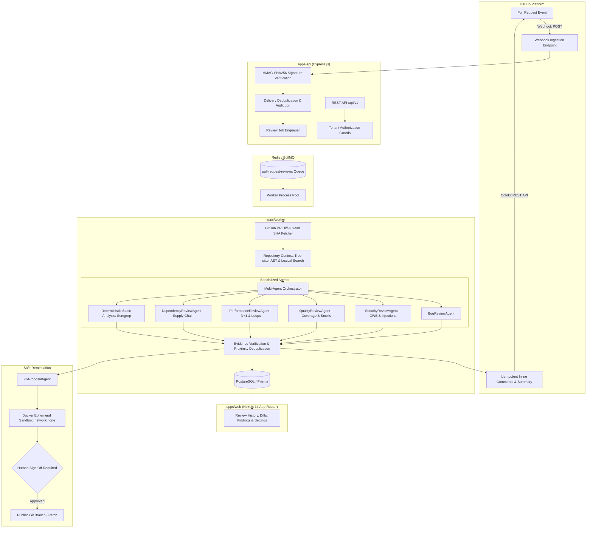

# RepoPilot 🚀
### Event-Driven Multi-Agent GitHub Code Reviewer & Safe Remediation Platform

RepoPilot is an enterprise-grade, event-driven multi-agent AI code review platform. It analyzes incoming GitHub pull requests using specialized agents (Logic/Bug, Security, Quality, Performance, Dependency), enriches diffs with Tree-sitter AST and symbol context, runs deterministic static analysis, verifies findings against exact source evidence, and publishes actionable, evidence-backed inline comments to GitHub.

---

## Architecture Blueprint



---

## Key Capabilities

- **Zero-Hallucination Evidence Gate:** Every published finding must point to a real modified diff line, have exact evidence matching the head SHA, and exceed a confidence threshold ($\ge 0.75$).
- **Multi-Agent Orchestration:** Specialized review agents run concurrently with fault-isolated promises (`Promise.allSettled`).
- **Tree-sitter AST Analysis:** Accurate symbol extraction and scope-aware context for TypeScript and Python.
- **Supply Chain & Performance Scanners:** Targets N+1 queries, $O(N^2)$ algorithmic loops, and manifest wildcard pins (`*`).
- **Safe Fix Proposal Sandbox:** Disposable, unprivileged Docker containers (`--network none`, non-root user, memory/CPU bounded) for validating fix proposals before any code is committed.
- **Human-in-the-Loop Sign-Off:** Automated actions never push directly to protected branches without explicit developer approval.
- **Repository Conventions Engine:** Custom guidelines, banned patterns, and confidence overrides via `.repopilot.json` or `.acr.json`.
- **Tenant Isolation & Concurrency Control:** In-memory and database-level tenancy guards preventing cross-tenant data leakage or queue starvation.

---

## Monorepo Layout

```
.
├── apps/
│   ├── api/                   # Express REST API, webhooks & tenant auth guards
│   ├── web/                   # Next.js 14 App Router review dashboard & diff viewer
│   └── worker/                # BullMQ background review worker & concurrency limiter
├── packages/
│   ├── agents/                # Bug, Security, Quality, Performance, Dependency & Fix agents
│   ├── database/              # PostgreSQL Prisma client & 10-table schema
│   ├── github/                # Octokit client, HMAC verification, diff parser & publisher
│   ├── observability/         # Pino structured logging & correlation IDs
│   ├── repository-context/    # Tree-sitter AST parser, symbol search & config loader
│   ├── review-contracts/      # Zod validation schemas for all domain entities
│   └── static-analysis/       # Semgrep adapter & isolated Docker sandbox runner
├── tests/
│   ├── evaluation/            # Automated benchmark evaluation harness & reporter
│   └── fixtures/              # Ground-truth PR patches (bugs, security, clean, perf, dep)
├── docker/
│   ├── docker-compose.yml     # Local PostgreSQL & Redis services
│   └── Dockerfile.sandbox     # Ephemeral unprivileged test sandbox image
└── docs/
    ├── audits/                # Automated benchmark reports
    └── plans/                 # Architecture specifications & implementation plans
```

---

## Benchmark Evaluation Results

Evaluated against the ground-truth benchmark suite:

| Metric | Measured Result | MVP Gate Target | Status |
|---|---|---|---|
| **Precision** | **100.0%** | $\ge 85.0\%$ | ✅ PASS |
| **False Positive Rate** | **0.0%** | $\le 15.0\%$ | ✅ PASS |
| **Recall** | **100.0%** | $\ge 75.0\%$ | ✅ PASS |
| **Diff Line Accuracy** | **100.0%** | $100\%$ | ✅ PASS |
| **Pipeline Crashes** | **0** | $0$ | ✅ PASS |

Full audit details can be inspected at [`docs/audits/mvp-benchmark-report.md`](docs/audits/mvp-benchmark-report.md).

---

## Getting Started

### Prerequisites
- **Node.js**: `20.x` or higher
- **pnpm**: `9.x`
- **Docker**: For running PostgreSQL, Redis, and isolated sandbox tests
- **Google Gemini API Key**: For LLM review agents

### 1. Clone & Install
```bash
git clone https://github.com/Pritam-72/RepoPilot.git
cd RepoPilot
pnpm install
```

### 2. Configure Environment
Copy `.env.example` to `.env` and fill in your keys:
```bash
cp .env.example .env
```

### 3. Start Local Services (PostgreSQL & Redis)
```bash
docker compose -f docker/docker-compose.yml up -d
```

### 4. Push Database Schema
```bash
pnpm --filter @acr/database db:push
```

### 5. Run Development Servers
```bash
pnpm dev
```
- **API Server:** `http://localhost:3000`
- **Web Dashboard:** `http://localhost:3001`

---

## Testing & Quality Verification

```bash
# Typecheck all 10 packages in monorepo
pnpm run typecheck

# Run full unit & integration test suite
pnpm run test

# Run benchmark evaluation gate across all fixtures
pnpm test:benchmark

# Generate full benchmark markdown report
pnpm run benchmark
```

---

## License

This project is licensed under the MIT License.

