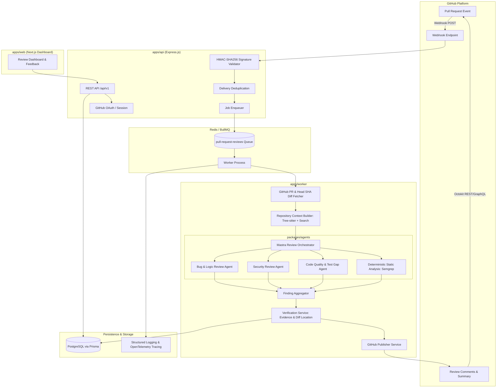

# Agentic Code Reviewer Implementation Plan

> **For Claude / Agent:** REQUIRED SUB-SKILL: Use superpowers:executing-plans to implement this plan task-by-task.

**Goal:** Build a production-grade, GitHub-integrated multi-agent code review platform that ingests pull request webhooks, builds repository-aware context, orchestrates specialized LLM agents (Bug, Security, Quality) and deterministic static analysis (Semgrep), strictly verifies evidence and diff locations, publishes actionable inline comments/summaries to GitHub, and displays review results in a Next.js dashboard.

**Architecture:** Event-driven TypeScript monorepo with an Express API webhook receiver, BullMQ/Redis worker pipeline, PostgreSQL/Prisma persistence, Mastra-based agent orchestration with strict Zod validation schemas, Tree-sitter AST & lexical context extraction, evidence verification and deduplication engine, Octokit review publisher, and Next.js/Tailwind/shadcn dashboard.

**Tech Stack:** TypeScript, Node.js 20+, Express.js, Mastra Agent Framework, Zod, Octokit (@octokit/app, @octokit/rest), PostgreSQL, Prisma ORM, Redis, BullMQ, Tree-sitter, Semgrep CLI, Vitest, Next.js 14+ (App Router), Tailwind CSS, shadcn/ui.

---

## 1. Architectural Blueprint & Monorepo Topology



### Monorepo Structure

```text
agentic-code-reviewer/
├── apps/
│   ├── api/                              # Express REST API & Webhook receiver
│   │   ├── src/
│   │   │   ├── routes/                   # /auth, /repositories, /reviews, /findings
│   │   │   ├── middleware/               # Auth, rate-limiting, error handling
│   │   │   ├── webhooks/                 # GitHub webhook handler & signature verification
│   │   │   └── server.ts
│   │   ├── tsconfig.json
│   │   └── package.json
│   ├── worker/                           # BullMQ background review processing
│   │   ├── src/
│   │   │   ├── processors/               # review-job.processor.ts
│   │   │   ├── queues/                   # queue definitions & worker setup
│   │   │   └── worker.ts
│   │   ├── tsconfig.json
│   │   └── package.json
│   └── web/                              # Next.js 14+ App Router Dashboard
│       ├── src/
│       │   ├── app/                      # pages: /, /repositories, /reviews/[id]
│       │   ├── components/               # UI components, diff viewer, finding cards
│       │   └── lib/                      # API client, auth session
│       ├── tsconfig.json
│       └── package.json
├── packages/
│   ├── review-contracts/                 # Shared Zod schemas & TypeScript types
│   │   ├── src/
│   │   │   ├── findings.schema.ts        # FindingSchema, AgentOutputSchema
│   │   │   ├── review-input.schema.ts    # ReviewAgentInput
│   │   │   ├── events.schema.ts          # Webhook payload & job payload types
│   │   │   └── index.ts
│   │   ├── tsconfig.json
│   │   └── package.json
│   ├── database/                         # Prisma ORM & Database Access
│   │   ├── prisma/
│   │   │   └── schema.prisma             # users, repositories, review_jobs, findings, etc.
│   │   ├── src/
│   │   │   ├── client.ts                 # Prisma singleton
│   │   │   └── repositories/             # Database access repositories
│   │   └── package.json
│   ├── github/                           # Octokit wrapper & Git operations
│   │   ├── src/
│   │   │   ├── client.ts                 # Installation-scoped Octokit client factory
│   │   │   ├── pr-service.ts             # Fetch PR metadata, head SHA, diffs, files
│   │   │   ├── publisher.ts              # Idempotent review comment and summary publisher
│   │   │   └── diff-parser.ts            # Git diff hunk parser and line range mapper
│   │   └── package.json
│   ├── repository-context/               # Bounded code retrieval & AST parser
│   │   ├── src/
│   │   │   ├── context-builder.ts        # Context orchestrator and token budget manager
│   │   │   ├── ast-parser.ts             # Tree-sitter queries for symbols & scopes
│   │   │   ├── search.ts                 # Lexical symbol/caller search
│   │   │   └── language-detector.ts      # Language and file type classification
│   │   └── package.json
│   ├── static-analysis/                  # Deterministic linters & scanners
│   │   ├── src/
│   │   │   ├── runner.ts                 # Adapter interface & execution sandbox
│   │   │   ├── semgrep-adapter.ts        # Semgrep rules & output normalizer
│   │   │   └── types.ts
│   │   └── package.json
│   ├── agents/                           # Mastra Agent Framework & Review Agents
│   │   ├── src/
│   │   │   ├── orchestrator.ts           # Review workflow state machine
│   │   │   ├── bug-agent.ts              # Logic & bug review agent
│   │   │   ├── security-agent.ts         # Vulnerability & injection agent
│   │   │   ├── quality-agent.ts          # Maintainability & test gap agent
│   │   │   ├── verification-service.ts   # Evidence verification & deduplication
│   │   │   └── llm-provider.ts           # Model provider adapter (Gemini/Claude/OpenAI)
│   │   └── package.json
│   └── observability/                    # Logging, correlation IDs, and metrics
│       ├── src/
│       │   ├── logger.ts                 # Pino structured logger with secret redaction
│       │   ├── metrics.ts                # Review duration, token cost, failure metrics
│       │   └── correlation.ts            # Trace / correlation ID propagation
│       └── package.json
├── docker/
│   ├── docker-compose.yml                # Local postgres, redis, api, worker
│   └── Dockerfile.sandbox                # Disposable container for static analysis / tests
├── tests/
│   ├── fixtures/                         # Test PR diffs (known bugs, security flaws, clean)
│   │   ├── bug-prs/
│   │   ├── security-prs/
│   │   └── clean-prs/
│   ├── integration/                      # API, Queue, and Database integration tests
│   └── evaluation/                       # Accuracy, false-positive & benchmark harness
├── package.json                          # Root workspace package.json
├── pnpm-workspace.yaml                   # Monorepo workspaces
├── turbo.json                            # Turborepo task pipeline
└── .env.example
```

---

## 2. Technical Decisions & Open Item Confirmations

Before starting implementation, the architectural choices mandated by PRD Section 16 & TRD Section 20 are resolved as follows:

| Dimension | Decision | Rationale |
|-----------|----------|-----------|
| **Initial Languages** | **TypeScript/JavaScript & Python** | Covers majority of web/backend PRs, excellent Tree-sitter grammars and Semgrep rulesets. |
| **Default LLM Provider** | **Google Gemini (Gemini 2.0 Flash / Pro)** with Claude/OpenAI adapters | High reasoning capability, large context window (1M+ tokens), cost efficiency for file context. |
| **Agent Framework** | **Mastra** | Built for TypeScript, native support for tools, workflows, state transitions, and structured output. |
| **GitHub App Permissions** | Minimum least-privilege: `Pull requests: Read & Write`, `Repository contents: Read`, `Metadata: Read`, `Checks: Write`. | Strictly sufficient for reading diffs, fetching source, and publishing comments/summaries. |
| **Review Context Limits** | Max 50 changed files, max 1MB diff, max 128k input tokens budget per agent run. | Prevents model timeouts, excessive API costs, and context dilution. |
| **Review State Lifecycle** | `queued` $\to$ `fetching` $\to$ `contextualizing` $\to$ `planning` $\to$ `analyzing` $\to$ `verifying` $\to$ `publishing` $\to$ `completed` / `failed`. | Fully auditable and recoverable with timestamps and correlation IDs. |
| **Comment Publication Mode** | **Direct Idempotent Publication** (Inline on valid diff lines + Summary comment) with user preview in dashboard. | Fulfills core MVP automation while preventing duplicate spam. |

---

## 3. Phased Implementation Roadmap

The implementation is broken down into 8 sequential milestones, starting with a strict foundational setup and working through an end-to-end single-agent slice before expanding to multi-agent orchestration.

```mermaid
flowchart LR
    P0[Phase 0: Setup & Fixtures] --> P1[Phase 1: Foundation Monorepo]
    P1 --> P2[Phase 2: GitHub Webhook & Ingestion]
    P2 --> P3[Phase 3: Vertical Slice 1 Agent]
    P3 --> P4[Phase 4: Context & Static Analysis]
    P4 --> P5[Phase 5: Multi-Agent Orchestrator]
    P5 --> P6[Phase 6: Verification & Publication]
    P6 --> P7[Phase 7: Dashboard & Evaluation]
    P7 -.-> P8[Phase 8: Post-MVP Fix Agent]
```



---

## Phase 0: Environment Configuration, Benchmark Fixtures & App Registration [COMPLETED]

### Goal
Establish test repositories, deterministic review fixtures (known bugs, security vulnerabilities, clean code), and GitHub App credentials without writing production code.

### Task 0.1: Test Fixtures and Benchmark Set [DONE]
- **Files:**
  - Create: `tests/fixtures/bug-prs/off-by-one.patch`
  - Create: `tests/fixtures/bug-prs/unhandled-null.patch`
  - Create: `tests/fixtures/security-prs/sql-injection.patch`
  - Create: `tests/fixtures/security-prs/path-traversal.patch`
  - Create: `tests/fixtures/clean-prs/refactor-clean.patch`
  - Create: `tests/fixtures/expected-findings.json`
- **Steps:**
  1. Define 5 standardized pull request patches representing distinct categories: correctness, security, maintainability, and clean code.
  2. Map expected finding metadata in `expected-findings.json` (expected file, line, severity, category, rule id).
  3. Verify fixtures with test diff parser.

### Task 0.2: GitHub App Registration Guide & Environment Template [DONE]
- **Files:**
  - Create: `.env.example`
  - Create: `docs/setup/github-app-guide.md`
- **Steps:**
  1. Document GitHub App permissions, webhook event subscriptions (`pull_request`, `installation`), and private key generation.
  2. Populate `.env.example` with all configuration variables specified in TRD Section 17.

---

## Phase 1: Repository & Backend Foundation [COMPLETED]

### Goal
Initialize the TypeScript monorepo, configure Prisma with PostgreSQL, setup BullMQ with Redis, and establish strict Zod contracts and structured logging.

### Task 1.1: Monorepo Workspace & TypeScript Configuration [DONE]
- **Files:**
  - Create: `package.json`
  - Create: `pnpm-workspace.yaml` or `package.json` workspaces
  - Create: `turbo.json`
  - Create: `tsconfig.base.json`
  - Create: `.gitignore`
- **TDD Steps:**
  1. *Step 1:* Run `pnpm -v` or `npm -v` and initialize root workspace configuration.
  2. *Step 2:* Configure strict TypeScript options (`strict: true`, `noImplicitAny: true`, `target: ES2022`).
  3. *Step 3:* Verify root linting and type-checking scripts execute without error.

### Task 1.2: Shared Review Contracts (`packages/review-contracts`) [DONE]
- **Files:**
  - Create: `packages/review-contracts/package.json`
  - Create: `packages/review-contracts/tsconfig.json`
  - Create: `packages/review-contracts/src/findings.schema.ts`
  - Create: `packages/review-contracts/src/review-input.schema.ts`
  - Create: `packages/review-contracts/src/events.schema.ts`
  - Create: `packages/review-contracts/src/index.ts`
  - Test: `packages/review-contracts/tests/contracts.test.ts`
- **TDD Steps:**
  1. *Step 1: Write the failing test* testing `FindingSchema` validation for severity, category, confidence ranges [0, 1], and `verificationStatus`.
  2. *Step 2: Run test to verify it fails* (`pnpm test`).
  3. *Step 3: Write minimal implementation* defining Zod schemas matching TRD Section 5.2.
  4. *Step 4: Run test to verify it passes*.
  5. *Step 5: Commit:* `feat(contracts): implement shared Zod finding and review schemas`.

### Task 1.3: Observability Module (`packages/observability`) [DONE]
- **Files:**
  - Create: `packages/observability/package.json`
  - Create: `packages/observability/src/logger.ts`
  - Create: `packages/observability/src/correlation.ts`
  - Create: `packages/observability/src/index.ts`
  - Test: `packages/observability/tests/logger.test.ts`
- **TDD Steps:**
  1. *Step 1: Write failing test* verifying logger redacts tokens (`GITHUB_TOKEN`, private keys, API keys) and injects correlation IDs.
  2. *Step 2: Run test to verify it fails*.
  3. *Step 3: Implement Pino-based logger* with redaction masks and request correlation context.
  4. *Step 4: Run test to verify it passes*.
  5. *Step 5: Commit:* `feat(observability): add structured logging with secret redaction`.

### Task 1.4: Database & Prisma Schema (`packages/database`) [DONE]
- **Files:**
  - Create: `packages/database/package.json`
  - Create: `packages/database/prisma/schema.prisma`
  - Create: `packages/database/src/client.ts`
  - Create: `packages/database/src/index.ts`
  - Create: `docker/docker-compose.yml`
  - Test: `packages/database/tests/schema.test.ts`
- **TDD Steps:**
  1. *Step 1: Write Docker Compose* defining PostgreSQL 16 and Redis 7 containers with health checks.
  2. *Step 2: Define Prisma schema* modeling all 10 core tables from TRD Section 8.1 (`users`, `github_installations`, `repositories`, `pull_requests`, `webhook_deliveries`, `review_jobs`, `agent_runs`, `findings`, `finding_feedback`, `fix_proposals`).
  3. *Step 3: Write migration* (`prisma migrate dev --name init`).
  4. *Step 4: Write test verifying relations and unique constraints* (e.g. `idempotency_key`, `github_delivery_id`).
  5. *Step 5: Commit:* `feat(database): define Prisma schema and initial PostgreSQL migrations`.

### Task 1.5: Express API Application (`apps/api`) [DONE]
- **Files:**
  - Create: `apps/api/package.json`
  - Create: `apps/api/src/config/env.ts`
  - Create: `apps/api/src/middleware/error-handler.ts`
  - Create: `apps/api/src/routes/health.ts`
  - Create: `apps/api/src/server.ts`
  - Test: `apps/api/tests/health.test.ts`
- **TDD Steps:**
  1. *Step 1: Write failing test* checking `GET /health` returns status `200` with uptime and db status.
  2. *Step 2: Run test to verify it fails*.
  3. *Step 3: Implement Express app* with JSON parsing, Zod environment validation, and error middleware.
  4. *Step 4: Run test to verify it passes*.
  5. *Step 5: Commit:* `feat(api): create Express API service and health checks`.

### Task 1.6: Review Worker & BullMQ Queue (`apps/worker`) [DONE]
- **Files:**
  - Create: `apps/worker/package.json`
  - Create: `apps/worker/src/queues/review-queue.ts`
  - Create: `apps/worker/src/processors/test-job.processor.ts`
  - Create: `apps/worker/src/worker.ts`
  - Test: `apps/worker/tests/queue.test.ts`
- **TDD Steps:**
  1. *Step 1: Write failing test* verifying BullMQ queue enqueues a review payload and a worker consumes it.
  2. *Step 2: Run test to verify it fails*.
  3. *Step 3: Implement BullMQ worker* with exponential backoff retry and stalled-job handling.
  4. *Step 4: Run test to verify it passes*.
  5. *Step 5: Commit:* `feat(worker): setup BullMQ review queue and base worker runner`.

---

## Phase 2: GitHub App Ingestion & Webhook Pipeline [COMPLETED]

### Goal
Implement secure GitHub webhook intake, HMAC-SHA256 signature verification, delivery idempotency, and Octokit PR metadata/diff retrieval pinned to the head SHA.

### Task 2.1: Webhook HMAC Signature Verification [DONE]
- **Files:**
  - Create: `apps/api/src/webhooks/verify-signature.ts`
  - Modify: `apps/api/src/server.ts` (attach raw body buffer)
  - Test: `apps/api/tests/webhooks/signature.test.ts`
- **TDD Steps:**
  1. *Step 1: Write failing test* verifying that requests with invalid `X-Hub-Signature-256` or tampered bodies return `401 Unauthorized`, while valid HMAC-SHA256 signatures succeed.
  2. *Step 2: Run test to verify it fails*.
  3. *Step 3: Implement crypto timing-safe comparison* using `crypto.timingSafeEqual`.
  4. *Step 4: Run test to verify it passes*.
  5. *Step 5: Commit:* `feat(api): implement raw-body GitHub webhook HMAC signature verification`.

### Task 2.2: Idempotent Webhook Intake Handler [DONE]
- **Files:**
  - Create: `apps/api/src/webhooks/handler.ts`
  - Create: `apps/api/src/routes/webhooks.ts`
  - Test: `apps/api/tests/webhooks/idempotency.test.ts`
- **TDD Steps:**
  1. *Step 1: Write failing test* verifying duplicate webhook deliveries with the same `X-GitHub-Delivery` ID are recorded and ignored without enqueuing duplicate review jobs.
  2. *Step 2: Run test to verify it fails*.
  3. *Step 3: Implement handler* filtering for actions (`opened`, `reopened`, `synchronize`), recording `webhook_deliveries`, generating the stable idempotency key, and enqueueing to BullMQ.
  4. *Step 4: Run test to verify it passes*.
  5. *Step 5: Commit:* `feat(api): add idempotent PR webhook handler and BullMQ dispatch`.

### Task 2.3: Octokit Client & Git Diff Parser (`packages/github`) [DONE]
- **Files:**
  - Create: `packages/github/package.json`
  - Create: `packages/github/src/client.ts`
  - Create: `packages/github/src/diff-parser.ts`
  - Create: `packages/github/src/pr-service.ts`
  - Test: `packages/github/tests/diff-parser.test.ts`
  - Test: `packages/github/tests/pr-service.test.ts`
- **TDD Steps:**
  1. *Step 1: Write failing tests* parsing unified Git diff hunks (calculating old/new line numbers, additions, deletions, modified ranges).
  2. *Step 2: Run test to verify it fails*.
  3. *Step 3: Implement diff parser* mapping patch lines to absolute file line numbers and detecting file renames, deletes, and binaries.
  4. *Step 4: Implement Octokit client factory* utilizing App ID and private key for installation authentication, fetching files at exact head SHA.
  5. *Step 5: Run tests to verify they pass*.
  6. *Step 6: Commit:* `feat(github): implement installation Octokit client and diff hunk parser`.

---

## Phase 3: Vertical Slice: Single Bug Review Agent [COMPLETED]

### Goal
Implement a single end-to-end review slice: worker receives job, fetches PR diff, invokes BugReviewAgent via Mastra, validates output against Zod schema, and stores findings in the database.

### Task 3.1: LLM Provider Adapter [DONE] (`packages/agents/src/llm-provider.ts`)
- **Files:**
  - Create: `packages/agents/package.json`
  - Create: `packages/agents/src/llm-provider.ts`
  - Test: `packages/agents/tests/llm-provider.test.ts`
- **TDD Steps:**
  1. *Step 1: Write failing test* with mocked model API asserting structured output generation and timeout handling.
  2. *Step 2: Implement adapter* integrating Google Gemini (via `@google/genai` or `@ai-sdk/google`) with schema-enforced output.
  3. *Step 3: Run test to verify it passes*.
  4. *Step 4: Commit:* `feat(agents): create unified LLM provider adapter with structured output`.

### Task 3.2: Bug and Logic Review Agent [DONE]
- **Files:**
  - Create: `packages/agents/src/bug-agent.ts`
  - Create: `packages/agents/src/prompts/bug-agent.prompt.ts`
  - Test: `packages/agents/tests/bug-agent.test.ts`
- **TDD Steps:**
  1. *Step 1: Write failing test* running `BugReviewAgent` against fixture `tests/fixtures/bug-prs/off-by-one.patch`. Assert finding contains `category: "correctness"`, valid line number, and evidence.
  2. *Step 2: Run test against clean fixture* `tests/fixtures/clean-prs/refactor-clean.patch` and assert empty findings array `[]`.
  3. *Step 3: Implement prompt and agent* using Mastra Agent, instructing the model to distinguish observed evidence from inference and reject hallucinating locations.
  4. *Step 4: Run test to verify it passes*.
  5. *Step 5: Commit:* `feat(agents): implement Mastra BugReviewAgent with Zod contract validation`.

### Task 3.3: End-to-End Worker Review Pipeline Execution [DONE]
- **Files:**
  - Modify: `apps/worker/src/processors/review-job.processor.ts`
  - Test: `apps/worker/tests/e2e-slice.test.ts`
- **TDD Steps:**
  1. *Step 1: Write integration test* pushing a mock PR review job to BullMQ, executing worker, and verifying `review_jobs`, `agent_runs`, and `findings` records are created in PostgreSQL.
  2. *Step 2: Run test to verify it fails*.
  3. *Step 3: Implement processor orchestration* connecting GitHub PR fetching, BugAgent execution, and Prisma persistence.
  4. *Step 4: Run test to verify it passes*.
  5. *Step 5: Commit:* `feat(worker): complete end-to-end single-agent review processing slice`.

---

## Phase 4: Repository Context & Deterministic Static Analysis [COMPLETED]

### Goal
Provide agents with surrounding syntactic context using Tree-sitter AST queries, lexical search, and incorporate deterministic findings from Semgrep.

### Task 4.1: Tree-sitter Code Parser & Language Detector [DONE]
- **Files:**
  - Create: `packages/repository-context/package.json`
  - Create: `packages/repository-context/src/language-detector.ts`
  - Create: `packages/repository-context/src/ast-parser.ts`
  - Test: `packages/repository-context/tests/ast-parser.test.ts`
- **TDD Steps:**
  1. *Step 1: Write failing test* parsing a TypeScript and Python snippet to locate enclosing functions, classes, and parameter types for changed line ranges.
  2. *Step 2: Run test to verify it fails*.
  3. *Step 3: Implement Tree-sitter bindings* (`tree-sitter`, `tree-sitter-typescript`, `tree-sitter-python`) to query enclosing node boundaries.
  4. *Step 4: Run test to verify it passes*.
  5. *Step 5: Commit:* `feat(context): add Tree-sitter AST parsing for enclosing scopes and symbols`.

### Task 4.2: Context Builder & Budget Manager [DONE]
- **Files:**
  - Create: `packages/repository-context/src/context-builder.ts`
  - Create: `packages/repository-context/src/search.ts`
  - Test: `packages/repository-context/tests/context-builder.test.ts`
- **TDD Steps:**
  1. *Step 1: Write failing test* verifying that the context builder retrieves relevant definitions, enforces token budget limits (e.g. 50k tokens), and redacts detected secrets.
  2. *Step 2: Run test to verify it fails*.
  3. *Step 3: Implement symbol search & bounded file windowing* attributing source provenance (commit SHA, file path, line range).
  4. *Step 4: Run test to verify it passes*.
  5. *Step 5: Commit:* `feat(context): implement bounded repository context builder and token budgeting`.

### Task 4.3: Deterministic Static Analysis Adapter (`packages/static-analysis`) [DONE]
- **Files:**
  - Create: `packages/static-analysis/package.json`
  - Create: `packages/static-analysis/src/runner.ts`
  - Create: `packages/static-analysis/src/semgrep-adapter.ts`
  - Test: `packages/static-analysis/tests/semgrep.test.ts`
- **TDD Steps:**
  1. *Step 1: Write failing test* executing Semgrep CLI (or mock JSON output) against `tests/fixtures/security-prs/sql-injection.patch` and normalizing output into `FindingSchema`.
  2. *Step 2: Run test to verify it fails*.
  3. *Step 3: Implement adapter* invoking Semgrep in a constrained process with timeout, parsing JSON results, and mapping to target commit file/lines.
  4. *Step 4: Run test to verify it passes*.
  5. *Step 5: Commit:* `feat(static-analysis): add Semgrep adapter and findings normalizer`.

---

## Phase 5: Multi-Agent Orchestration [COMPLETED]

### Goal
Implement Mastra review orchestrator coordinating Bug, Security, and Quality/Test-Gap review agents alongside static analysis with concurrency controls and partial-failure handling.

### Task 5.1: Security Review Agent [DONE]
- **Files:**
  - Create: `packages/agents/src/security-agent.ts`
  - Create: `packages/agents/src/prompts/security-agent.prompt.ts`
  - Test: `packages/agents/tests/security-agent.test.ts`
- **TDD Steps:**
  1. *Step 1: Write failing test* with SQL injection and path traversal fixtures. Assert agent identifies CWE/vulnerability, explains attacker control path, and cites exact lines.
  2. *Step 2: Implement prompt* emphasizing untrusted inputs, sanitize checks, and correlation with Semgrep findings.
  3. *Step 3: Run test to verify it passes*.
  4. *Step 4: Commit:* `feat(agents): implement SecurityReviewAgent with injection & CWE detection`.

### Task 5.2: Code Quality & Test-Gap Agent [DONE]
- **Files:**
  - Create: `packages/agents/src/quality-agent.ts`
  - Create: `packages/agents/src/prompts/quality-agent.prompt.ts`
  - Test: `packages/agents/tests/quality-agent.test.ts`
- **TDD Steps:**
  1. *Step 1: Write failing test* with changed complex business logic lacking corresponding test additions. Assert agent reports missing test coverage with `category: "testing"`.
  2. *Step 2: Implement prompt* focusing on maintainability risks, unhandled edge cases in test suites, and project test patterns.
  3. *Step 3: Run test to verify it passes*.
  4. *Step 4: Commit:* `feat(agents): implement CodeQualityAndTestGapAgent`.

### Task 5.3: Mastra Review Orchestrator & State Machine [DONE]
- **Files:**
  - Create: `packages/agents/src/orchestrator.ts`
  - Test: `packages/agents/tests/orchestrator.test.ts`
- **TDD Steps:**
  1. *Step 1: Write failing test* verifying the orchestrator executes Bug, Security, and Quality agents in parallel (with concurrency limit = 3), records individual `agent_runs`, and continues if one non-critical agent times out.
  2. *Step 2: Implement Mastra workflow* managing review states (`planning`, `analyzing`, `verifying`), routing files based on extensions, and aggregating findings.
  3. *Step 3: Run test to verify it passes*.
  4. *Step 4: Commit:* `feat(agents): implement Mastra review orchestrator with parallel dispatch and fault isolation`.

---

## Phase 6: Verification, Deduplication & GitHub Publication [COMPLETED]

### Goal
Filter hallucinated, unsupported, or duplicate findings, verify line numbers against the Git diff, and publish clean inline comments and a summary review to GitHub.

### Task 6.1: Finding Verification & Deduplication Engine [DONE]
- **Files:**
  - Create: `packages/agents/src/verification-service.ts`
  - Test: `packages/agents/tests/verification.test.ts`
- **TDD Steps:**
  1. *Step 1: Write failing tests:*
     - Reject finding where cited file or line does not exist at head SHA.
     - Reject finding where evidence snippet does not match file contents.
     - Deduplicate two agents reporting the same bug with different wording (fingerprint similarity).
     - Filter findings below confidence threshold (< 0.75).
  2. *Step 2: Run test to verify it fails*.
  3. *Step 3: Implement verification rules* computing stable fingerprints (`sha256(file + line + category + ruleId)`), checking diff boundaries, and setting `verificationStatus: "verified" | "rejected"`.
  4. *Step 4: Run test to verify it passes*.
  5. *Step 5: Commit:* `feat(verification): implement evidence verification and finding deduplication`.

### Task 6.2: GitHub Review Publisher [DONE]
- **Files:**
  - Create: `packages/github/src/publisher.ts`
  - Test: `packages/github/tests/publisher.test.ts`
- **TDD Steps:**
  1. *Step 1: Write failing test* verifying:
     - Verified findings within diff lines are posted as inline comments (`pulls.createReviewComment`).
     - Findings outside diff lines are compiled into the markdown review summary.
     - Retrying a completed job does not duplicate GitHub comments (idempotency checks).
  2. *Step 2: Implement publisher* constructing structured review body, executing Octokit review calls, and storing `github_comment_id`.
  3. *Step 3: Run test to verify it passes*.
  4. *Step 4: Commit:* `feat(github): implement idempotent PR review summary and inline comment publisher`.

---

## Phase 7: Web Dashboard, Observability & Pilot Hardening

### Goal
Build the Next.js web application for monitoring reviews, inspecting findings, submitting developer feedback, and hardening the platform for pilot testing.

### Task 7.1: Next.js Dashboard & Repository List (`apps/web`)
- **Files:**
  - Create: `apps/web/package.json`
  - Create: `apps/web/src/app/layout.tsx`
  - Create: `apps/web/src/app/page.tsx`
  - Create: `apps/web/src/app/repositories/page.tsx`
  - Create: `apps/web/src/components/nav.tsx`
  - Create: `apps/web/src/components/repo-card.tsx`
  - Test: `apps/web/tests/dashboard.test.tsx`
- **TDD Steps:**
  1. *Step 1: Write failing component tests* for repository list and status indicators.
  2. *Step 2: Implement Next.js app* with Tailwind CSS and shadcn/ui components, fetching repositories and active review runs.
  3. *Step 3: Run test to verify it passes*.
  4. *Step 4: Commit:* `feat(web): build repository overview and review run list dashboard`.

### Task 7.2: Review Run Detail & Finding Feedback UI
- **Files:**
  - Create: `apps/web/src/app/reviews/[id]/page.tsx`
  - Create: `apps/web/src/components/finding-card.tsx`
  - Create: `apps/web/src/components/diff-viewer.tsx`
  - Create: `apps/web/src/components/feedback-button.tsx`
  - Test: `apps/web/tests/review-detail.test.tsx`
- **TDD Steps:**
  1. *Step 1: Write failing test* verifying findings grouped by severity (Critical, High, Medium, Low), evidence display, and feedback submission (`useful`, `incorrect`, `dismissed`).
  2. *Step 2: Implement review detail view* with Monaco/Diff viewer and interactive feedback actions.
  3. *Step 3: Run test to verify it passes*.
  4. *Step 4: Commit:* `feat(web): build review detail view with diff viewer and finding feedback`.

### Task 7.3: Benchmark Evaluation Harness & Pilot Readiness Gate
- **Files:**
  - Create: `tests/evaluation/run-benchmark.ts`
  - Create: `tests/evaluation/benchmark-reporter.ts`
  - Test: `tests/evaluation/benchmark.test.ts`
- **TDD Steps:**
  1. *Step 1: Implement evaluation script* running all Phase 0 fixtures through the review pipeline.
  2. *Step 2: Compute precision, recall, false-positive rate, and localization accuracy* against `tests/fixtures/expected-findings.json`.
  3. *Step 3: Verify MVP gate criteria:* Precision $\ge 85\%$, False-positive rate $\le 15\%$, 100% valid diff line references, zero crashes.
  4. *Step 4: Commit:* `test(eval): add automated benchmark harness and evaluation reporter`.

---

## Phase 8: Safe Remediation & Fix Agent (Post-MVP Target)

### Goal
Provide human-approved, safely tested fix suggestions in an isolated Docker sandbox without risking repository integrity.

### Task 8.1: Isolated Docker Execution Sandbox
- **Files:**
  - Create: `docker/Dockerfile.sandbox`
  - Create: `packages/static-analysis/src/sandbox-runner.ts`
  - Test: `packages/static-analysis/tests/sandbox.test.ts`
- **TDD Steps:**
  1. *Step 1: Write sandbox security tests:* verify network isolation (`--network none`), non-root execution, CPU/memory limits, read-only root FS, and container destruction on timeout.
  2. *Step 2: Implement sandbox runner* mounting ephemeral worktrees.
  3. *Step 3: Commit:* `feat(sandbox): implement disposable, network-isolated Docker sandbox runner`.

### Task 8.2: Fix Proposal Agent & Approval Flow
- **Files:**
  - Create: `packages/agents/src/fix-agent.ts`
  - Create: `apps/api/src/routes/fix-proposals.ts`
  - Test: `packages/agents/tests/fix-agent.test.ts`
- **TDD Steps:**
  1. *Step 1: Write failing test* generating minimal unified diff patch for a verified finding, executing tests in sandbox, and asserting tests pass.
  2. *Step 2: Implement Fix Agent* with explicit requirement for human sign-off before publishing a git branch.
  3. *Step 3: Commit:* `feat(remediation): implement FixAgent and human-in-the-loop branch creation`.

---

## 4. Verification Checklists & Quality Gates

### Pre-Commit Gate
- [ ] TypeScript compilation (`tsc --noEmit`) passes with zero errors.
- [ ] ESLint passes without warnings.
- [ ] Unit & integration tests pass (`pnpm test`).
- [ ] No secrets, keys, or raw tokens present in code or committed config.

### Review Run Verification Gate
- [ ] Cited file paths exist in the pull request commit.
- [ ] Inline comments point to lines modified in the diff hunk.
- [ ] Evidence text matches file content at target commit.
- [ ] Finding confidence score meets threshold ($\ge 0.75$).
- [ ] Stable fingerprint checked against previous findings to avoid duplicate GitHub comments.

---

## 5. Execution Handoff

Plan complete and ready for execution. Two execution options:

1. **Subagent-Driven (this session)** - Fresh subagent dispatched per task, code review between tasks, rapid iteration.
2. **Parallel Session (separate)** - Open a new session with `executing-plans`, batch execution with checkpoints.

**Which approach would you prefer?**

